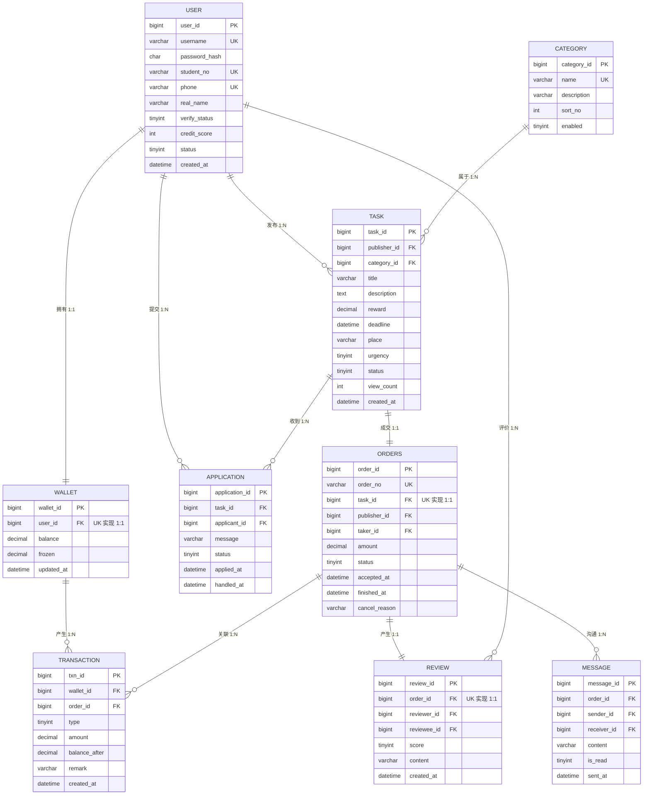
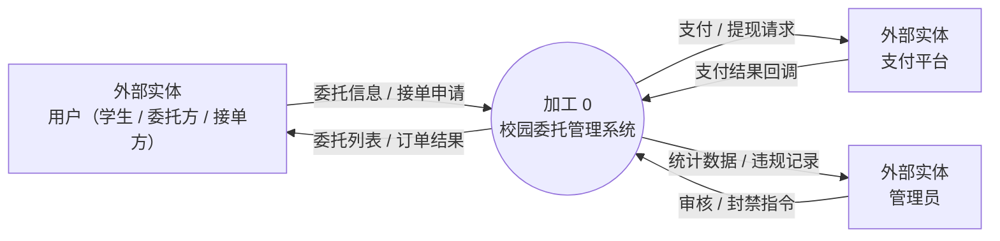
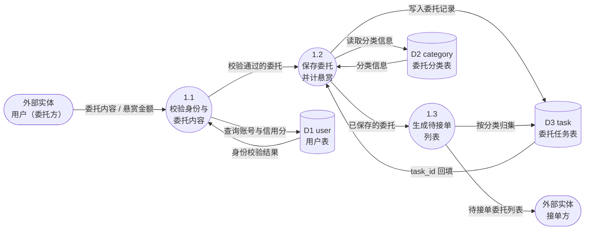
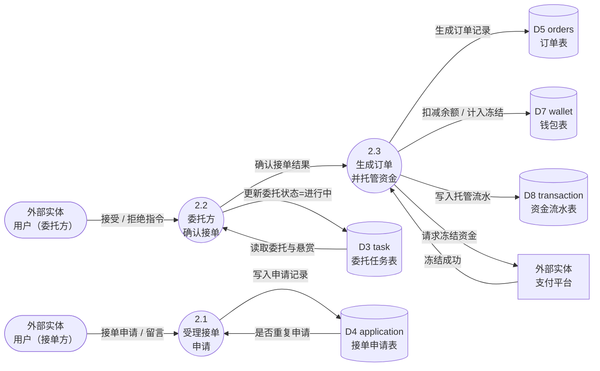

# 校园委托系统 —— 图表源码（Mermaid）

> ⚠️ **本文件为旧版（Chen 记法），其中的 ER 图与数据流图源码已过期，请勿使用。**
> 现行源码请看 **`11_ER图源码.md`**（含 ER 图三种格式 + 4 张数据流图），
> 或直接双击 **`图表_Mermaid.html`** 在浏览器里查看与编辑。

> 用途：在支持 Mermaid 的编辑器（Typora、VS Code、Notion、语雀）或 https://mermaid.live 中粘贴，
> 即可得到可编辑的 E-R 图与数据流图；也可照此在 PowerDesigner / Axure RP9 中重绘。

---

## 图1  E-R 图（实体关系，带基数）

---

## 图2  DFD-0 顶层图（上下文图）

---

## 图3  DFD-1 第 1 层：发布委托

---

## 图4  DFD-1 第 1 层：申请接单与订单成交

---

## 附：状态码字典（供数据字典与前端约定共用）

| 字段 | 取值 | 含义 |
|---|---|---|
| user.verify_status | 0 / 1 / 2 / 3 | 未认证 / 审核中 / 已认证 / 已驳回 |
| user.status | 0 / 1 | 禁用 / 正常 |
| task.urgency | 0 / 1 / 2 | 普通 / 加急 / 非常紧急 |
| task.status | 0 / 1 / 2 / 3 / 4 | 待接单 / 进行中 / 已完成 / 已取消 / 已关闭 |
| application.status | 0 / 1 / 2 / 3 | 待处理 / 已接受 / 已拒绝 / 已撤回 |
| orders.status | 0 / 1 / 2 / 3 / 4 | 进行中 / 待确认 / 已完成 / 已取消 / 已退款 |
| transaction.type | 1~6 | 充值 / 提现 / 支付托管 / 解冻退回 / 接单收入 / 平台服务费 |
| message.is_read | 0 / 1 | 未读 / 已读 |
