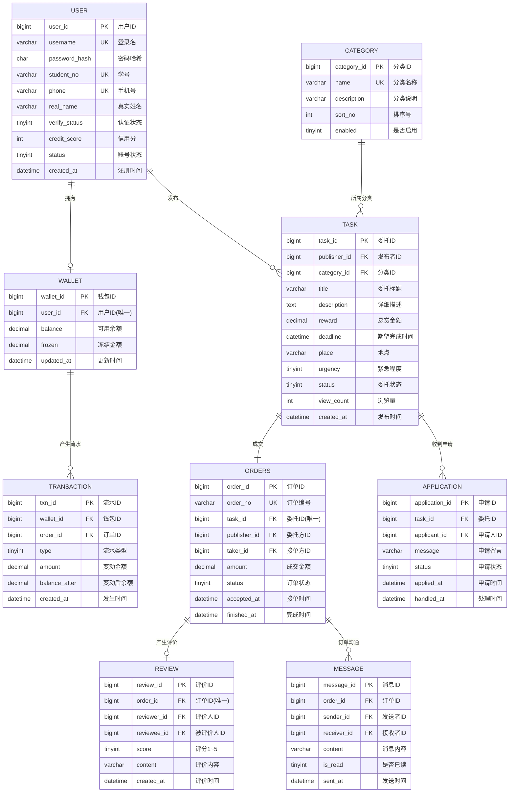
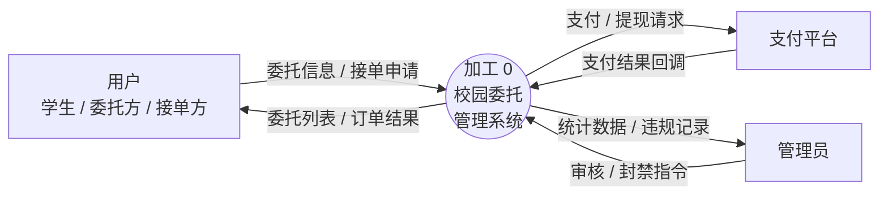
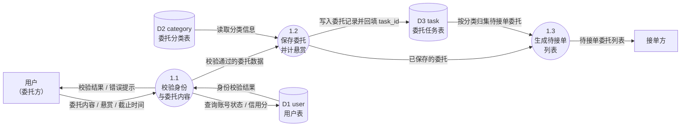
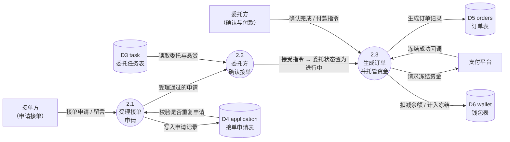
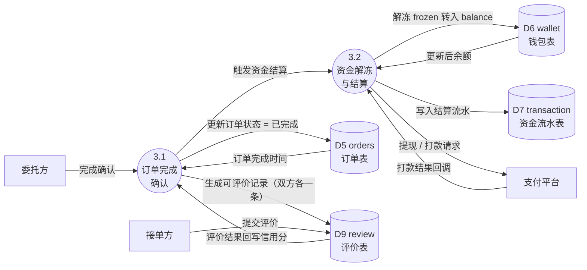

# 校园委托系统 —— E-R 图源码（三种可选格式）
> 三种格式任选：① Mermaid（在线渲染，最方便）　② Graphviz DOT（最标准，符号最像课本）　③ Python/Pillow（就是当前 PNG 的出图代码）
>
> **想直接在浏览器里看和改**：双击 `图表_Mermaid.html`，ER 图 + 4 张数据流图都在里面（分标签页，需联网）。

---

## ① Mermaid ER 图源码

可直接粘贴到 https://mermaid.live 渲染，或在 Typora / VS Code(Markdown Preview Mermaid) / 语雀 中查看。



> 基数记号读法：`||` 一（强制）　`|o` 零或一　`}|` 一或多　`}o` 零或多

---

## ② Graphviz DOT 源码

保存为 `er.dot`，执行 `dot -Tpng er.dot -o er.png`（需装 Graphviz）。
本格式用**真正的鸦爪形状**（`crow` / `tee` / `odot` 箭头）表达基数，最接近课本样式。

```dot
digraph campus_commission_er {
    rankdir=LR;
    graph [fontname="Microsoft YaHei", bgcolor="white", splines=ortho, nodesep=0.6, ranksep=1.2];
    node  [shape=plaintext, fontname="Microsoft YaHei", fontsize=11];
    edge  [fontname="Microsoft YaHei", fontsize=10, color="#465A78", penwidth=1.6];

    /* ---------- 实体：用 HTML 表格实现「表名 + 字段 + PK/FK 标注」 ---------- */
    USER [label=<
      <TABLE BORDER="1" CELLBORDER="1" CELLSPACING="0" CELLPADDING="4" COLOR="#2F5597">
        <TR><TD BGCOLOR="#2F5597"><FONT COLOR="white"><B>USER 用户</B></FONT></TD></TR>
        <TR><TD ALIGN="LEFT" BGCOLOR="#FFF2CC">user_id  BIGINT  <B>PK</B></TD></TR>
        <TR><TD ALIGN="LEFT">username  VARCHAR(50)  UQ</TD></TR>
        <TR><TD ALIGN="LEFT">password_hash  CHAR(60)</TD></TR>
        <TR><TD ALIGN="LEFT">student_no  VARCHAR(20)  UQ</TD></TR>
        <TR><TD ALIGN="LEFT">phone  VARCHAR(20)  UQ</TD></TR>
        <TR><TD ALIGN="LEFT">real_name  VARCHAR(50)</TD></TR>
        <TR><TD ALIGN="LEFT">verify_status  TINYINT</TD></TR>
        <TR><TD ALIGN="LEFT">credit_score  INT</TD></TR>
        <TR><TD ALIGN="LEFT">created_at  DATETIME</TD></TR>
      </TABLE>>];

    CATEGORY [label=<
      <TABLE BORDER="1" CELLBORDER="1" CELLSPACING="0" CELLPADDING="4" COLOR="#2F5597">
        <TR><TD BGCOLOR="#2F5597"><FONT COLOR="white"><B>CATEGORY 委托分类</B></FONT></TD></TR>
        <TR><TD ALIGN="LEFT" BGCOLOR="#FFF2CC">category_id  BIGINT  <B>PK</B></TD></TR>
        <TR><TD ALIGN="LEFT">name  VARCHAR(50)  UQ</TD></TR>
        <TR><TD ALIGN="LEFT">description  VARCHAR(255)</TD></TR>
        <TR><TD ALIGN="LEFT">sort_no  INT</TD></TR>
        <TR><TD ALIGN="LEFT">enabled  TINYINT</TD></TR>
      </TABLE>>];

    TASK [label=<
      <TABLE BORDER="1" CELLBORDER="1" CELLSPACING="0" CELLPADDING="4" COLOR="#2F5597">
        <TR><TD BGCOLOR="#2F5597"><FONT COLOR="white"><B>TASK 委托任务</B></FONT></TD></TR>
        <TR><TD ALIGN="LEFT" BGCOLOR="#FFF2CC">task_id  BIGINT  <B>PK</B></TD></TR>
        <TR><TD ALIGN="LEFT">publisher_id  BIGINT  <B>FK</B></TD></TR>
        <TR><TD ALIGN="LEFT">category_id  BIGINT  <B>FK</B></TD></TR>
        <TR><TD ALIGN="LEFT">title  VARCHAR(100)</TD></TR>
        <TR><TD ALIGN="LEFT">description  TEXT</TD></TR>
        <TR><TD ALIGN="LEFT">reward  DECIMAL(10,2)</TD></TR>
        <TR><TD ALIGN="LEFT">deadline  DATETIME</TD></TR>
        <TR><TD ALIGN="LEFT">place  VARCHAR(100)</TD></TR>
        <TR><TD ALIGN="LEFT">urgency  TINYINT</TD></TR>
        <TR><TD ALIGN="LEFT">status  TINYINT</TD></TR>
        <TR><TD ALIGN="LEFT">created_at  DATETIME</TD></TR>
      </TABLE>>];

    APPLICATION [label=<
      <TABLE BORDER="1" CELLBORDER="1" CELLSPACING="0" CELLPADDING="4" COLOR="#2F5597">
        <TR><TD BGCOLOR="#2F5597"><FONT COLOR="white"><B>APPLICATION 接单申请</B></FONT></TD></TR>
        <TR><TD ALIGN="LEFT" BGCOLOR="#FFF2CC">application_id  BIGINT  <B>PK</B></TD></TR>
        <TR><TD ALIGN="LEFT">task_id  BIGINT  <B>FK</B></TD></TR>
        <TR><TD ALIGN="LEFT">applicant_id  BIGINT  <B>FK</B></TD></TR>
        <TR><TD ALIGN="LEFT">message  VARCHAR(255)</TD></TR>
        <TR><TD ALIGN="LEFT">status  TINYINT</TD></TR>
        <TR><TD ALIGN="LEFT">applied_at  DATETIME</TD></TR>
        <TR><TD ALIGN="LEFT">handled_at  DATETIME</TD></TR>
      </TABLE>>];

    ORDERS [label=<
      <TABLE BORDER="1" CELLBORDER="1" CELLSPACING="0" CELLPADDING="4" COLOR="#2F5597">
        <TR><TD BGCOLOR="#2F5597"><FONT COLOR="white"><B>ORDERS 订单</B></FONT></TD></TR>
        <TR><TD ALIGN="LEFT" BGCOLOR="#FFF2CC">order_id  BIGINT  <B>PK</B></TD></TR>
        <TR><TD ALIGN="LEFT">order_no  VARCHAR(32)  UQ</TD></TR>
        <TR><TD ALIGN="LEFT">task_id  BIGINT  <B>FK</B>,UQ</TD></TR>
        <TR><TD ALIGN="LEFT">publisher_id  BIGINT  <B>FK</B></TD></TR>
        <TR><TD ALIGN="LEFT">taker_id  BIGINT  <B>FK</B></TD></TR>
        <TR><TD ALIGN="LEFT">amount  DECIMAL(10,2)</TD></TR>
        <TR><TD ALIGN="LEFT">status  TINYINT</TD></TR>
        <TR><TD ALIGN="LEFT">accepted_at  DATETIME</TD></TR>
        <TR><TD ALIGN="LEFT">finished_at  DATETIME</TD></TR>
      </TABLE>>];

    REVIEW [label=<
      <TABLE BORDER="1" CELLBORDER="1" CELLSPACING="0" CELLPADDING="4" COLOR="#2F5597">
        <TR><TD BGCOLOR="#2F5597"><FONT COLOR="white"><B>REVIEW 评价</B></FONT></TD></TR>
        <TR><TD ALIGN="LEFT" BGCOLOR="#FFF2CC">review_id  BIGINT  <B>PK</B></TD></TR>
        <TR><TD ALIGN="LEFT">order_id  BIGINT  <B>FK</B>,UQ</TD></TR>
        <TR><TD ALIGN="LEFT">reviewer_id  BIGINT  <B>FK</B></TD></TR>
        <TR><TD ALIGN="LEFT">reviewee_id  BIGINT  <B>FK</B></TD></TR>
        <TR><TD ALIGN="LEFT">score  TINYINT  (1~5)</TD></TR>
        <TR><TD ALIGN="LEFT">content  VARCHAR(500)</TD></TR>
        <TR><TD ALIGN="LEFT">created_at  DATETIME</TD></TR>
      </TABLE>>];

    WALLET [label=<
      <TABLE BORDER="1" CELLBORDER="1" CELLSPACING="0" CELLPADDING="4" COLOR="#2F5597">
        <TR><TD BGCOLOR="#2F5597"><FONT COLOR="white"><B>WALLET 钱包</B></FONT></TD></TR>
        <TR><TD ALIGN="LEFT" BGCOLOR="#FFF2CC">wallet_id  BIGINT  <B>PK</B></TD></TR>
        <TR><TD ALIGN="LEFT">user_id  BIGINT  <B>FK</B>,UQ</TD></TR>
        <TR><TD ALIGN="LEFT">balance  DECIMAL(12,2)</TD></TR>
        <TR><TD ALIGN="LEFT">frozen  DECIMAL(12,2)</TD></TR>
        <TR><TD ALIGN="LEFT">updated_at  DATETIME</TD></TR>
      </TABLE>>];

    TRANSACTION [label=<
      <TABLE BORDER="1" CELLBORDER="1" CELLSPACING="0" CELLPADDING="4" COLOR="#2F5597">
        <TR><TD BGCOLOR="#2F5597"><FONT COLOR="white"><B>TRANSACTION 资金流水</B></FONT></TD></TR>
        <TR><TD ALIGN="LEFT" BGCOLOR="#FFF2CC">txn_id  BIGINT  <B>PK</B></TD></TR>
        <TR><TD ALIGN="LEFT">wallet_id  BIGINT  <B>FK</B></TD></TR>
        <TR><TD ALIGN="LEFT">order_id  BIGINT  <B>FK</B></TD></TR>
        <TR><TD ALIGN="LEFT">type  TINYINT</TD></TR>
        <TR><TD ALIGN="LEFT">amount  DECIMAL(12,2)</TD></TR>
        <TR><TD ALIGN="LEFT">balance_after  DECIMAL(12,2)</TD></TR>
        <TR><TD ALIGN="LEFT">created_at  DATETIME</TD></TR>
      </TABLE>>];

    MESSAGE [label=<
      <TABLE BORDER="1" CELLBORDER="1" CELLSPACING="0" CELLPADDING="4" COLOR="#2F5597">
        <TR><TD BGCOLOR="#2F5597"><FONT COLOR="white"><B>MESSAGE 站内消息</B></FONT></TD></TR>
        <TR><TD ALIGN="LEFT" BGCOLOR="#FFF2CC">message_id  BIGINT  <B>PK</B></TD></TR>
        <TR><TD ALIGN="LEFT">order_id  BIGINT  <B>FK</B></TD></TR>
        <TR><TD ALIGN="LEFT">sender_id  BIGINT  <B>FK</B></TD></TR>
        <TR><TD ALIGN="LEFT">receiver_id  BIGINT  <B>FK</B></TD></TR>
        <TR><TD ALIGN="LEFT">content  VARCHAR(500)</TD></TR>
        <TR><TD ALIGN="LEFT">is_read  TINYINT</TD></TR>
        <TR><TD ALIGN="LEFT">sent_at  DATETIME</TD></TR>
      </TABLE>>];

    /* ---------- 关系连线：鸦爪符号 = 基数 ---------- */
    /* USER 一 -> TASK 零或多 */
    USER   -> TASK        [label="发布 1:N",     dir=both, arrowtail=tee,  arrowhead=crow];
    /* TASK 一 -> ORDERS 恰一（1:1） */
    TASK   -> ORDERS      [label="成交 1:1",     dir=both, arrowtail=tee,  arrowhead=tee];
    /* USER 一 -> WALLET 零或一（1:1） */
    USER   -> WALLET      [label="拥有 1:1",     dir=both, arrowtail=tee,  arrowhead=odot];
    /* TASK 一 -> APPLICATION 零或多 */
    TASK   -> APPLICATION [label="收到申请 1:N", dir=both, arrowtail=tee,  arrowhead=crow];
    /* ORDERS 一 -> REVIEW 零或一（1:1） */
    ORDERS -> REVIEW      [label="产生评价 1:1", dir=both, arrowtail=tee,  arrowhead=odot];
    /* ORDERS 一 -> MESSAGE 零或多 */
    ORDERS -> MESSAGE     [label="订单沟通 1:N", dir=both, arrowtail=tee,  arrowhead=crow];
    /* CATEGORY 一 -> TASK 零或多 */
    CATEGORY -> TASK      [label="所属分类 1:N", dir=both, arrowtail=tee,  arrowhead=crow];
    /* WALLET 一 -> TRANSACTION 零或多 */
    WALLET -> TRANSACTION [label="产生流水 1:N", dir=both, arrowtail=tee,  arrowhead=crow];
}
```



### DOT 中鸦爪记号的对应关系

| 基数 | arrowtail / arrowhead |
|---|---|
| 一（强制） | `tee`（竖线） |
| 零或一 | `odot`（圆圈） |
| 一或多 | `tee` + `crow`（组合时用两次边或 `crow` 加 `tee`） |
| 零或多 | `crow`（鸦爪）+ `odot` |

> 注：Graphviz 单个箭头只能表达一个记号。若要严格的「零或多」双记号，最稳妥的做法是
> 用 `arrowhead=crow` 表示"多"、`arrowtail=tee` 表示"一"，即上表写法；零/可选性用 `odot`。

---

## ③ Python / Pillow 出图源码

即当前 PNG 的真实生成代码，见工程目录文件：`build_er_new.py`

- 依赖：仅 `Pillow`（无需 Graphviz / Mermaid）
- 运行：`python build_er_new.py` → 输出 `03_图1_ER图.png`
- 结构：
  1. `TB` 字典：9 个实体的字段清单（含 PK/FK/UQ 标注文本）
  2. `GEO` 字典：9 个实体的画布坐标（**改坐标即可调整版面**）
  3. `end_mark()`：绘制四种鸦爪基数记号
  4. `connect()`：绘制连线 + 在两端按基数画记号 + 标注关系名
  5. `fig()`：先画实体框，再画连线，最后画图例

### 修改指引

| 想改什么 | 改哪里 |
|---|---|
| 增删字段 | `TB` 里对应实体的列表 |
| 调整位置 | `GEO` 里对应实体的 `(x, y, 列号)` |
| 加一条关系 | `fig()` 末尾加一句 `connect(d, [起点, 终点], 'one', 'optmany', "关系名", (标注x, 标注y))` |
| 改基数含义 | `connect` 的第 3、4 个参数：`one` / `opt1` / `many` / `optmany` |
| 改配色 | 顶部 `ENT_BG / ENT_HD / REL_* / LINE / CARD` 常量 |
| 改画布大小 | `fig()` 里的 `W, H` |


---

## ④ 数据流图（DFD）Mermaid 源码

与 `图表_Mermaid.html`、`build_dfd.py` 出图内容一致。数据存储编号全项目统一：
**D1** user · **D2** category · **D3** task · **D4** application · **D5** orders · **D6** wallet · **D7** transaction · **D9** review

图元：`[矩形]` 外部实体　`((圆))` 加工　`[(…)]` 数据存储　`-->` 数据流

### 图2　DFD-0 顶层图（上下文图）



### 图3　DFD-1 第 1 层：发布委托



### 图4　DFD-1 第 1 层：申请接单与订单成交



### 图7　DFD-1 第 1 层：结算、评价与消息



### 如需重新生成 PNG

```powershell
python "C:\Users\林炯汉\Documents\deepseek-harness\default-workspace\campus-commission\build_dfd.py"
```

输出：`04_图2_DFD0顶层图.png`、`05_图3_DFD1发布委托.png`、`06_图4_DFD2接单成交.png`、`12_图7_DFD3结算评价.png`
